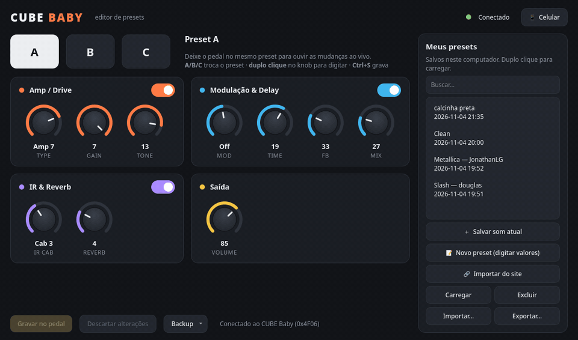
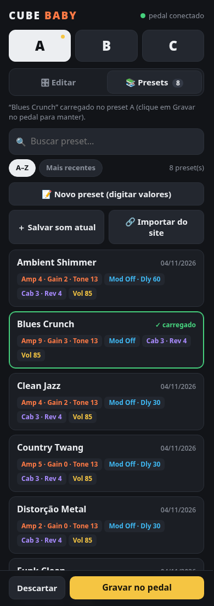

# Cube Baby Editor

Editor de presets para o pedal **M-VAVE / Cuvave CUBE Baby** (versão para guitarra elétrica) no
**Windows** e no **Linux**.
Ajuste os knobs pelo computador, ouça na hora, grave nos presets A/B/C do pedal e guarde quantos sons
quiser no seu computador.



> ⚠️ Este app é para o **CUBE Baby elétrico** (o pedal se identifica com o id `0x4F06`).
> Para o **Cube Baby AC** (violão), use o [cubebaby-editor](https://github.com/walbertfreitas/cubebaby-editor).
> Software não oficial, sem ligação com a M-VAVE/Cuvave. Use por sua conta e risco.

---

## ⬇️ Download (jeito fácil)

Baixe o arquivo do seu sistema na página de **[Releases](https://github.com/GusCfer/guitar-cubebaby-editor/releases/latest)**.
Não precisa instalar Python nem driver.

| Sistema | Arquivo | Como abrir |
|---|---|---|
| **Windows 10/11** | `CubeBabyEditor-windows.exe` | Dois cliques. Se aparecer *"O Windows protegeu o computador"*, clique em **Mais informações → Executar assim mesmo** (o app não é assinado digitalmente). |
| **Linux (x86_64)** | `CubeBabyEditor-linux-x86_64` | `chmod +x CubeBabyEditor-linux-x86_64` e depois `./CubeBabyEditor-linux-x86_64` (ou dois cliques no gerenciador de arquivos). |

> No Ubuntu/Debian, se a janela não abrir, instale `sudo apt install libxcb-cursor0`.

Onde ficam seus presets e backups:

| Sistema | Pasta |
|---|---|
| Windows | `%APPDATA%\cube-baby-editor\` |
| Linux | `~/.local/share/cube-baby-editor/` |

---

## Instalação pelo código-fonte (Linux)

Prefira esse jeito se quiser acompanhar as atualizações com `git pull` ou mexer no código.

### 1. Instale as dependências

Você precisa de **Python 3.10+**, **PyQt6** e **python-rtmidi**. Escolha o comando da sua distribuição:

| Distribuição | Comando |
|---|---|
| Arch, CachyOS, Manjaro, EndeavourOS | `sudo pacman -S --needed python-pyqt6 python-rtmidi git` |
| Ubuntu 24.04+, Debian 12+, Mint 22+, Pop!_OS, Zorin 17+ | `sudo apt install python3-pyqt6 python3-rtmidi git` |
| Fedora | `sudo dnf install python3-pyqt6 python3-rtmidi git` |
| openSUSE | `sudo zypper install python3-PyQt6 python3-python-rtmidi git` |

<details>
<summary>Minha distribuição não tem esses pacotes (usar pip)</summary>

```sh
python3 -m venv ~/.venvs/cubebaby
~/.venvs/cubebaby/bin/pip install PyQt6 python-rtmidi
# depois, rode sempre com:
~/.venvs/cubebaby/bin/python -m cubebaby_el
```
O `python-rtmidi` pode precisar dos pacotes de desenvolvimento do ALSA (`libasound2-dev` no Ubuntu,
`alsa-lib-devel` no Fedora) para compilar.
</details>

### 2. Baixe o editor

```sh
git clone https://github.com/GusCfer/guitar-cubebaby-editor.git cube-baby-editor
cd cube-baby-editor
```

Sem git? Na página do projeto clique em **Code → Download ZIP**, extraia e abra um terminal dentro da pasta.

### 3. Abra

```sh
./cube-baby-editor
```

Para colocar o app no **menu de aplicativos**, rode uma vez:

```sh
./install.sh            # cria o atalho "Cube Baby Editor"
./install.sh --remove   # remove o atalho
```

### Atualizar

```sh
cd cube-baby-editor && git pull
```

---

## Como usar

1. Ligue o pedal e conecte no USB. Feche o CubeSuite e outros editores que estejam usando o pedal.
2. Abra o editor: ele conecta sozinho e faz um **backup automático** dos presets A/B/C.
3. Escolha o preset **A, B ou C** — e deixe o pedal no mesmo preset para ouvir as mudanças.
4. Ajuste os knobs. As alterações são aplicadas **ao vivo**, mas só ficam salvas no pedal quando você clicar
   em **Gravar no pedal**.

### Controles

| Ação | Como |
|---|---|
| Girar knob | arrastar para cima/baixo, roda do mouse ou setas ↑ ↓ (Shift+roda = passo maior) |
| Digitar valor | duplo clique no knob, ou selecionar o knob e digitar o número → **Enter** (Esc cancela) |
| Trocar preset | teclas **A / B / C**, **Ctrl+1/2/3** ou **F1/F2/F3** (Ctrl+PgUp/PgDn = anterior/próximo) |
| Ligar/desligar seção | chave no canto de cada cartão (Amp/Drive, Modulação & Delay, IR & Reverb) |
| Gravar no pedal | botão **Gravar no pedal** ou **Ctrl+S** |
| Desfazer edição | **Descartar alterações** volta ao que está gravado no pedal |

### 📱 Controle pelo celular



1. No computador, clique em **📱 Celular** (canto superior direito).
2. Aponte a câmera do celular para o QR code e abra o link. O celular precisa estar na **mesma rede Wi-Fi**.
3. Pronto: sliders, botões − / +, toque no valor para digitar, troca de A/B/C, liga/desliga de seções,
   **Gravar no pedal** e seus presets salvos — tudo pelo navegador do celular, sem instalar nada.

O computador continua ligado ao pedal pelo USB e repassa os comandos; dá para usar a tela do PC e o celular ao
mesmo tempo. O link tem uma chave aleatória; **Desligar acesso** invalida o link (um novo QR é gerado da próxima
vez).

> **Linux com firewall (ufw/firewalld):** libere a porta uma vez, só para a rede local, por exemplo
> `sudo ufw allow from 192.168.0.0/16 to any port 8765 proto tcp`.
> **Windows:** na primeira vez o Windows pergunta sobre o firewall — permita em **redes privadas**.

### Meus presets (no computador)

- **📝 Novo preset (digitar valores)** (Ctrl+N): formulário com nome, os 10 valores e o liga/desliga das seções.
  Digite e use **Tab** para pular de campo (no celular, **Enter**). Começa com o som atual; **Valores padrão**
  zera para um som neutro. **Salvar** só guarda; **Salvar e carregar** já aplica no pedal.
- **＋ Salvar som atual** guarda o som em `~/.local/share/cube-baby-editor/presets/`.
- **Duplo clique** num preset da lista carrega ele no preset atual (A/B/C) — depois é só gravar no pedal.
- Botão direito: substituir, renomear, exportar ou excluir. **Importar/Exportar** usam arquivos `.json`,
  fáceis de compartilhar.

<br clear="right">

### 🔗 Importar presets do site cube-baby-presets

1. Copie o link de um preset em [cube-baby-presets.vercel.app](https://cube-baby-presets.vercel.app/pt/presets/)
   (modelo **Cube Baby**), por exemplo `https://cube-baby-presets.vercel.app/pt/presets/902`.
2. No editor, clique em **🔗 Importar do site** e cole o link (ou só o número, `902`).
   No celular: aba **Presets → 🔗 Importar do site**.
3. O preset é salvo em *Meus presets* com nome e autor e já é carregado no preset atual.

Como a página do site é montada por JavaScript, o editor a abre num navegador do próprio computador
(**Chrome, Edge, Brave ou Chromium**) em modo invisível e lê os valores da tela. No Windows o Edge já vem
instalado. A primeira importação leva uns 20 s (o navegador prepara um perfil próprio do editor); as próximas
levam cerca de 1 s. Também dá para colar o texto da página (Ctrl+A, Ctrl+C) no lugar do link.
Presets do Cube Baby AC ou Bass são recusados, porque os knobs são outros.

### Backup

Cada conexão gera um backup em `~/.local/share/cube-baby-editor/backups/`. No menu **Backup** você pode
exportar o banco atual ou restaurar um backup no pedal.

### Valores

| Knob | Faixa | Observação |
|---|---|---|
| TYPE | Amp 1–9 | modelo de amplificador |
| GAIN | 0–7 | |
| TONE | 0–15 | |
| MOD | 0–15 | 0–6 chorus · 7–8 desligado · 9–15 phaser |
| TIME | 0–31 | tempo do delay |
| FB | 0–127 | repetições do delay |
| MIX | 0–118 | volume do delay |
| IR CAB | 0–8 | gabinete (IR) |
| REVERB | 0–15 | |
| VOLUME | 0–127 | |

---

## Problemas comuns

| Problema | Solução |
|---|---|
| "Pedal não encontrado" | Confira o cabo (alguns cabos USB só carregam, não transmitem dados). No Linux, `amidi -l` deve mostrar `USB2.0 Device MIDI 1`; no Windows, o pedal aparece no Gerenciador de Dispositivos em *Dispositivos de som, vídeo e jogos*. |
| Windows: "Sem resposta" ou pedal ocupado | No Windows só um programa por vez pode usar o MIDI do pedal: feche o CubeSuite, DAWs e outros editores. |
| "Sem resposta do pedal" | Feche outros programas que usam o pedal (CubeSuite no Wine, DAWs) e clique em **Conectar**. |
| "Modelo não suportado" | Seu pedal não é o CUBE Baby elétrico (`0x4F06`). Para o modelo AC use o cubebaby-editor. |
| Mexo na tela e o som não muda | Deixe o pedal no mesmo preset (A/B/C) selecionado no editor. |
| Girei um knob físico e a tela não mudou | É normal: o pedal não informa a posição dos knobs físicos ao computador. |
| `ModuleNotFoundError: PyQt6` / `rtmidi` | Instale as dependências do passo 1. |
| Celular não abre a página | Confira se está na mesma rede Wi-Fi (não na rede de visitantes nem nos dados móveis), libere a porta 8765 no firewall e, na janela do QR, tente outro endereço em **Rede**. |

---

## Segurança

O editor **só escreve na área de presets** (banco 5) do pedal. A área de firmware/IRs (banco 0) é bloqueada no
código, e o upload de IRs não está implementado — não há risco de "brickar" o pedal pelo editor.

## Detalhes técnicos

<details>
<summary>Protocolo e mapa de memória</summary>

O pedal é USB class-compliant (driver `snd-usb-audio`, nada para instalar). O editor conversa por **MIDI SysEx**:
quadro `00 59 | CMD | LEN(u24) | DATA | CHK` empacotado em 7 bits. Detalhes em
[cubebaby-editor/docs/PROTOCOL.md](https://github.com/walbertfreitas/cubebaby-editor/blob/main/docs/PROTOCOL.md).

Presets: banco 5, endereço 0, 3 × 16 bytes. Edição ao vivo: `0x80000000 + slot*16 + byte`.

| byte | 0 | 1 | 2 | 3 | 4 | 5 | 6 | 7 | 8 | 9 | 10 | 11 | 12 |
|---|---|---|---|---|---|---|---|---|---|---|---|---|---|
| | TYPE | GAIN | TONE | REVERB | FB | VOLUME | TIME | MIX | MOD | IR CAB | IR on | MOD/DLY on | DRIVE on |

Estrutura do código:

| Arquivo | Função |
|---|---|
| `cubebaby_el/protocol.py` | quadros SysEx (empacotamento 7 bits, checksum) |
| `cubebaby_el/device.py` | conexão USB-MIDI, mapa de parâmetros, trava de segurança |
| `cubebaby_el/library.py` | presets e backups em JSON |
| `cubebaby_el/gui.py` | interface PyQt6 |
| `cubebaby_el/remote.py` + `assets/remote.html` | servidor HTTP local e página do controle pelo celular |
| `cubebaby_el/qr.py` | gerador de QR code embutido (sem dependências) |
| `cubebaby_el/site_import.py` | importação de presets pelo link do cube-baby-presets (navegador invisível) |
| `run.py` + `.github/workflows/release.yml` | build do `.exe`/binário (PyInstaller) e publicação nas Releases ao criar uma tag `v*` |
</details>

## Créditos

- [walbertfreitas/cubebaby-editor](https://github.com/walbertfreitas/cubebaby-editor) — transporte SysEx (MIT)
- [MrGariZack/cubecontrol](https://github.com/MrGariZack/cubecontrol) — mapa de parâmetros do CUBE Baby elétrico (MIT)

Licença: [MIT](LICENSE).

## Publicar uma nova versão (para o mantenedor)

1. Atualize `__version__` em `cubebaby_el/__init__.py`.
2. `git commit -am "v1.x.y" && git tag v1.x.y && git push && git push origin v1.x.y`
3. O GitHub Actions compila Windows e Linux e cria a Release sozinho (aba **Actions** mostra o progresso).
